<a href="https://nine19een.com">
  <picture>
    <source media="(prefers-color-scheme: dark)" srcset="./assets/banner-dark.svg">
    
  </picture>
</a>

<picture>
  <source media="(max-width: 600px)" srcset="./assets/card-dark-narrow.svg">
  
</picture>

[Website](https://nine19een.com) · [Writing](https://nine19een.com/writing/en/) · [Email](mailto:nine19eenowo@gmail.com) · [Bilibili](https://space.bilibili.com/404289521)

<a href="https://nine19een.com/projects/">
  <picture>
    <source media="(max-width: 600px)" srcset="./assets/session-projects-narrow.svg">
    
  </picture>
</a>

[`campus-oj`](https://oj.nine19een.com) · [`canvascast`](https://github.com/nine19een/CanvasCast) ([try it ↗](https://canvascast.nine19een.com), [Tech Weekly #398](https://www.ruanyifeng.com/blog/2026/05/weekly-issue-398.html)) · [`schedule`](https://schedule.nine19een.com) 课序 · [`arsenal-transfer-alert`](https://github.com/nine19een/arsenal-transfer-alert) · [More projects →](https://nine19een.com/projects/)

<a href="https://nine19een.com/writing/en/2026/10/09/agent-harness-round2-review/">
  <picture>
    <source media="(max-width: 600px)" srcset="./assets/session-experiments-narrow.svg">
    
  </picture>
</a>

[`agent-harness-lab`](https://nine19een.com/writing/en/2026/10/09/agent-harness-round2-review/) ([round 1](https://nine19een.com/writing/en/2026/08/15/agent-harness-lab-review/), [round 2](https://nine19een.com/writing/en/2026/10/09/agent-harness-round2-review/)) · [`video-to-handout`](https://github.com/nine19een/video-to-handout) ([the half-lecture post](https://nine19een.com/writing/en/2026/06/02/agent-workflow-validation/))

<a href="https://nine19een.com/writing/en/">
  <picture>
    <source media="(max-width: 600px)" srcset="./assets/session-writing-narrow.svg">
    
  </picture>
</a>

[`2026-10-09`](https://nine19een.com/writing/en/2026/10/09/agent-harness-round2-review/) · [`2026-09-22`](https://nine19een.com/writing/en/2026/09/22/chatgpt-clean-ip-proxy-chain/) · [`2026-05-10`](https://nine19een.com/writing/en/2026/05/10/abc457-e-crossing-table-cloth-review/) · [All 20+ posts →](https://nine19een.com/writing/en/) · [中文文章 →](https://nine19een.com/writing/) · [Practice archive →](https://github.com/nine19een/Coding-Practice)
