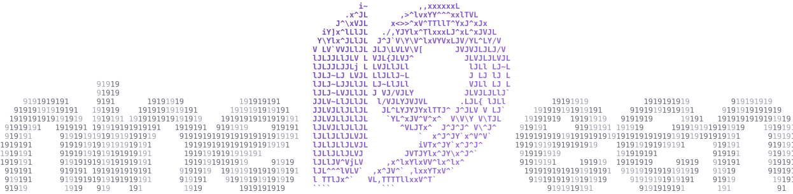

<a href="https://nine19een.com">
  <picture>
    <source media="(prefers-color-scheme: dark)" srcset="./assets/banner-dark.svg">
    
  </picture>
</a>

<picture>
  <source media="(max-width: 600px) and (prefers-color-scheme: dark)" srcset="./assets/card-dark-narrow.svg">
  <source media="(max-width: 600px)" srcset="./assets/card-light-narrow.svg">
  <source media="(prefers-color-scheme: dark)" srcset="./assets/card-dark.svg">
  
</picture>

[Website](https://nine19een.com) · [Writing](https://nine19een.com/writing/en/) · [Email](mailto:nine19eenowo@gmail.com) · [Bilibili](https://space.bilibili.com/404289521)

### `~/projects`

**[Campus OJ](https://oj.nine19een.com)** `live` `private source`  
An online judge built for my university's competitive programming team (~60 members), and already used for real training assignments and exams. Roles, problem library, classes, timed exams, and C++ / Java / Python judging, running on Linux with Docker.

**[CanvasCast](https://github.com/nine19een/CanvasCast)** `open source` · [try it ↗](https://canvascast.nine19een.com)  
A browser whiteboard for recording explanations: drawing, multiple pages, camera and mic, a teleprompter, video export. Featured in [Ruan Yifeng's Tech Weekly #398](https://www.ruanyifeng.com/blog/2026/05/weekly-issue-398.html).

**[课序 Schedule](https://schedule.nine19een.com)** `live` `private source`  
The timetable apps I tried were full of ads, so I made a quiet one for myself. More than half a semester of daily use so far.

### `~/experiments`

**Agent Harness Lab** · [round 1](https://nine19een.com/writing/en/2026/08/15/agent-harness-lab-review/) · [round 2](https://nine19een.com/writing/en/2026/10/09/agent-harness-round2-review/)  
Evaluated coding-agent workflows on 20 SWE-bench Lite tasks, with four independent runs per task. Agent Loop achieved a 67.5% success rate (54/80), compared with 31.25% (25/80) for one-shot generation. One experimental setup, not a model ranking.

**[Video-to-Handout](https://github.com/nine19een/video-to-handout)** `public repo`  
A Codex-driven workflow that turns lecture videos into slide-aligned notes, with checks at every stage, because [it once quietly left out half a lecture](https://nine19een.com/writing/en/2026/06/02/agent-workflow-validation/).

### `~/writing`

- [Agent Harness Lab Follow-up Experiment Retrospective](https://nine19een.com/writing/en/2026/10/09/agent-harness-round2-review/)
- [I Just Wanted a Clean IP for ChatGPT. Somehow I Ended Up Building a Proxy Chain.](https://nine19een.com/writing/en/2026/09/22/chatgpt-clean-ip-proxy-chain/)
- [AtCoder ABC457-E Review: Interval Unions, Structural Cases, and an Offline Fenwick Tree](https://nine19een.com/writing/en/2026/05/10/abc457-e-crossing-table-cloth-review/)

[All 20+ posts →](https://nine19een.com/writing/en/) · [中文 →](https://nine19een.com/writing/) · [Practice archive →](https://github.com/nine19een/Coding-Practice)
