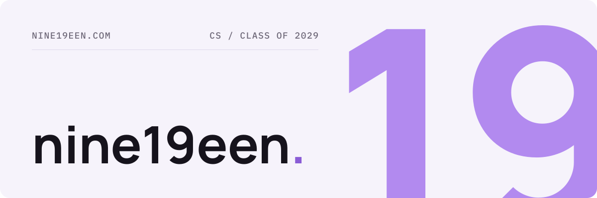
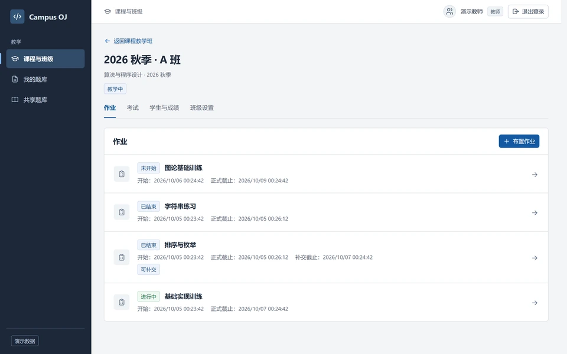
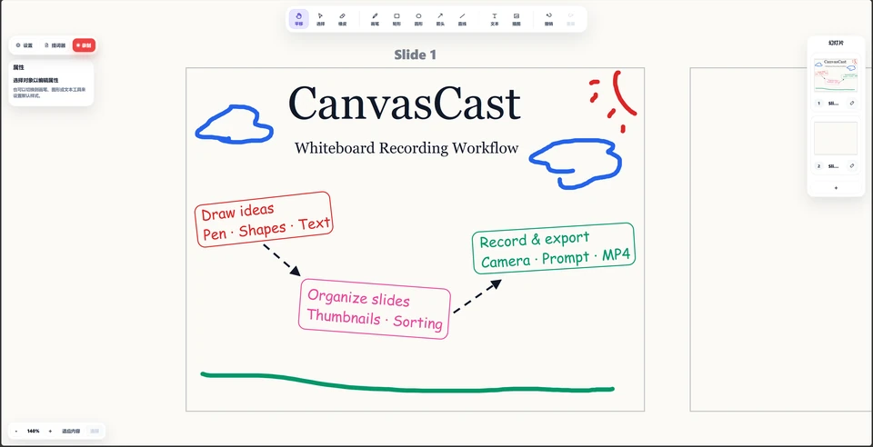

<a href="https://nine19een.com">
  <picture>
    <source media="(prefers-color-scheme: dark)" srcset="./assets/hero-dark.svg">
    <source media="(prefers-color-scheme: light)" srcset="./assets/hero-light.svg">
    
  </picture>
</a>

**I'm nine19een.** A second-year computer science student. I build software for problems I actually run into, usually with Codex or Claude in the loop, and I write down what breaks.

Right now that means *AI coding*, *coding agents*, and the engineering around them: testing, deployment, and keeping things running after launch.

[Website](https://nine19een.com) · [Writing](https://nine19een.com/writing/en/) · [Email](mailto:nine19eenowo@gmail.com) · [Bilibili](https://space.bilibili.com/404289521)

 

## Shipped.

### [Campus OJ ↗](https://oj.nine19een.com)

Our training team had nowhere good to run daily practice, assignments, and exams, so I built an online judge for it. Teacher, student, and admin roles; a problem library; classes and assignments; timed exams; C++, Java, and Python judging; grade export. It runs on a Linux server with Docker, sandboxed judging, and backups.

Built for my university's competitive programming team (~60 members), and already used for real training assignments and exams.

`live` `private source` · [Visit Campus OJ ↗](https://oj.nine19een.com) · [Product overview ↗](https://nine19een.com/projects/#campus-oj)

### [CanvasCast](https://github.com/nine19een/CanvasCast)

A browser whiteboard for recording short explanations. It started because I wanted an easier way to record algorithm walkthroughs. It now covers drawing, multiple pages, camera and microphone recording, a teleprompter, and video export, all in a desktop browser.

`open source` · Featured in [Ruan Yifeng's Tech Weekly #398](https://www.ruanyifeng.com/blog/2026/05/weekly-issue-398.html) · [Source](https://github.com/nine19een/CanvasCast) · [Try it ↗](https://canvascast.nine19een.com)

### [课序 · Schedule ↗](https://schedule.nine19een.com)

A timetable app for myself. The ones I tried were full of ads and looked cluttered, so I made a quiet one: import the timetable, check today's classes, works offline. I've been using it for more than half a semester.

`live` `private source` · [Open ↗](https://schedule.nine19een.com)

 

## Experimenting.

Using coding agents is one thing. These are attempts to find out why they work, and when they don't.

### Agent Harness Lab

Controlled code-repair experiments comparing one-shot generation, tool-free multi-turn revision, and an agent loop that can search, edit, and run code.

Evaluated coding-agent workflows on 20 SWE-bench Lite tasks, with four independent runs per task. Agent Loop achieved a 67.5% success rate (54/80), compared with 31.25% (25/80) for one-shot generation.

These numbers come from one experimental setup, not a model ranking. The write-ups cover the failure modes and what the numbers can't tell you.

`experiment` · [Round 1 write-up](https://nine19een.com/writing/en/2026/08/15/agent-harness-lab-review/) · [Round 2 write-up](https://nine19een.com/writing/en/2026/10/09/agent-harness-round2-review/)

### [Video-to-Handout](https://github.com/nine19een/video-to-handout)

A Codex-driven workflow that turns lecture videos into structured handouts: subtitle processing, key-frame extraction, alignment with slides, and a writer agent for the final notes, with intermediate results checked at each stage. Why the checks matter: [it once quietly left out half a lecture](https://nine19een.com/writing/en/2026/06/02/agent-workflow-validation/).

`public repo` · [Source](https://github.com/nine19een/video-to-handout)

 

## Writing.

20+ posts on AI coding, agent experiments, fixing real servers, and the occasional contest problem.

- `2026.10.09` [Agent Harness Lab Follow-up Experiment Retrospective](https://nine19een.com/writing/en/2026/10/09/agent-harness-round2-review/)
- `2026.09.22` [I Just Wanted a Clean IP for ChatGPT. Somehow I Ended Up Building a Proxy Chain.](https://nine19een.com/writing/en/2026/09/22/chatgpt-clean-ip-proxy-chain/)
- `2026.05.10` [AtCoder ABC457-E Review: Interval Unions, Structural Cases, and an Offline Fenwick Tree](https://nine19een.com/writing/en/2026/05/10/abc457-e-crossing-table-cloth-review/)

[All posts →](https://nine19een.com/writing/en/) · [中文文章 →](https://nine19een.com/writing/)

 

## How I work.

I use AI coding tools across the whole loop: defining the problem, choosing the architecture, reading the code they write, testing it, deploying it, and fixing it when it breaks. I read the diffs.

**Focus** — AI coding, agentic AI, coding agents, LLM application engineering  
**In practice** — web apps, Git, Linux servers, Docker, deployment, testing and validation  
**Foundation** — C++, algorithms and data structures; Python and Java in projects  
**Learning now** — PyTorch, deep learning and model training, and more systematic backend engineering

Competitive programming is where I started. In the 2026 Lanqiao Cup (C/C++, University Group B) I received a third prize in the national finals and a first prize in the Beijing provincial round. I founded and lead my university's training team, which is why Campus OJ exists. [Practice archive →](https://github.com/nine19een/Coding-Practice)

 

## Away from the keyboard.

Football (Arsenal, enough to build [a transfer alert service](https://github.com/nine19een/arsenal-transfer-alert) for it), badminton, the gym, piano, single-player games, and films.

## Say hello.

[nine19eenowo@gmail.com](mailto:nine19eenowo@gmail.com) — public repositories are pinned below.
